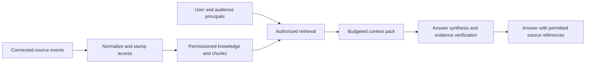

# Company Knowledge System

A company answer is only useful if you can see where it came from and you're allowed to read the underlying information.

I built this backend to normalize information from connected sources, check access before retrieval, and carry evidence references through to the answer. The code covers ingestion, permissions, retrieval and answer synthesis. This public export leaves out company records, credentials and the original frontend.

## Try the offline checks

You'll need Python 3.12 and access to a package index for installation. No API key or company account is needed.

```sh
python3.12 -m venv .venv
.venv/bin/python -m pip install -r requirements.txt
.venv/bin/python tools/verify_offline.py
```

The runner blocks socket connections and exercises the original tests with fictional source records and fake database/model ports. You can inspect how the backend handles permissions, retrieval and answer presentation. These checks don't run a live model, a connector or Postgres RLS, and they don't measure generated-answer quality. The measured results are in [verification](docs/VERIFICATION.md).

This is a backend source export. It isn't a complete app you can deploy from this checkout: the frontend, full ingestion workers and full migration chain aren't included. For file-based planning and research workflows, see [Company OS](https://github.com/namankumar/company-os-showcase).

## Follow the implementation

| Stage | Original source |
|---|---|
| Normalize connected-source events | [normalizers.py](app/ingestion/normalizers.py) |
| Enforce source access policy | [source_permissions.py](app/core/source_permissions.py), [permission_adapters.py](app/core/permission_adapters.py) |
| Stamp access envelopes | [acl_stamping.py](app/ingestion/acl_stamping.py) |
| Build authorized context | [retrieve.py](app/retrieval/retrieve.py), [pack_policies.py](app/retrieval/pack_policies.py) |
| Optional embeddings with search fallback | [embed.py](app/retrieval/embed.py) |
| Answer and verify evidence | [chat.py](app/synthesis/chat.py), [verifier.py](app/synthesis/verifier.py) |
| Project user-facing answers | [presentation/chat.py](app/presentation/chat.py) |
| API and tenant database context | [api/chat.py](app/api/chat.py), [db.py](app/core/db.py) |



The retrieval path filters tenant, principal, access state and permission freshness before ranking. Context-pack policies reserve space for different evidence views. The legacy unscoped context-pack API is deliberately disabled. Selected original RLS/access migrations are included as schema references; they are not a complete deployment migration chain.

## Export scope

The export includes the dependency modules used by the retrieval and answer code, including provider integration source where imported. No keys or accounts are configured. The offline verifier refuses network access.

Excluded: live source records and company documents, user/account databases, OAuth tokens and API keys, environment/deployment files, private logs/caches, administrative scripts, full ingestion workers, original application frontend, and private Git history. Identity labels and private email domains in source fixtures/policy have consistent reserved-example substitutions. The [export manifest](EXPORT-MANIFEST.json) records per-file provenance and content digests. No new license or third-party redistribution rights are asserted.
