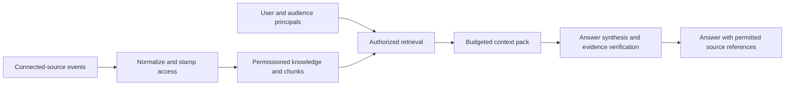

# Company Knowledge System

Original backend implementation from a company-knowledge application: ingest source-shaped information, apply source permissions, build an audience-bound context pack, and answer questions with evidence references. This is the actual retrieval/answer/permission code, exported without private company records, credentials, connector configuration or Git history. It is separate from the file-based [Company OS workflows](https://github.com/namankumar/company-os-showcase).

## Follow the implementation

| Stage | Original source |
|---|---|
| Normalize connected-source events | [normalizers.py](app/ingestion/normalizers.py) |
| Enforce source access policy | [source_permissions.py](app/core/source_permissions.py), [permission_adapters.py](app/core/permission_adapters.py) |
| Stamp access envelopes | [acl_stamping.py](app/ingestion/acl_stamping.py) |
| Build authorized context | [retrieve.py](app/retrieval/retrieve.py), [pack_policies.py](app/retrieval/pack_policies.py) |
| Optional embeddings with search fallback | [embed.py](app/retrieval/embed.py) |
| Answer and verify evidence | [chat.py](app/synthesis/chat.py), [verifier.py](app/synthesis/verifier.py) |
| Project user-facing answers | [presentation/chat.py](app/presentation/chat.py) |
| API and tenant database context | [api/chat.py](app/api/chat.py), [db.py](app/core/db.py) |



The retrieval path filters tenant, principal, access state and permission freshness before ranking. Context-pack policies reserve space for different evidence views. The legacy unscoped context-pack API is deliberately disabled. Selected original RLS/access migrations are included as schema references; they are not a complete deployment migration chain.

## Run the original offline tests

Python 3.12 is the verified interpreter. From a clean checkout:

```sh
python3.12 -m venv .venv
.venv/bin/python -m pip install -r requirements.txt
.venv/bin/python tools/verify_offline.py
```

Dependency installation needs a package index. The verification runner blocks socket connections before invoking the original tests. Tests use synthetic source/permission fixtures and fake database/model ports; they do not access a customer database or call a model/provider. Their results verify permission/retrieval and presentation mechanics within those fixtures, not live connector access, live Postgres RLS, deployment status, or generated-answer quality. See [verification](docs/VERIFICATION.md).

## Export scope

This is a focused source export from an existing application, not a newly written toy implementation or a turnkey hosted service. Dependency modules used by the original retrieval and answer code are included so the selected original tests run without stubs replacing the product. Provider integration source is retained where imported; no keys or accounts are configured, and the offline verifier refuses network access.

Excluded: live source records and company documents, user/account databases, OAuth tokens and API keys, environment/deployment files, private logs/caches, administrative scripts, full ingestion workers, original application frontend, and private Git history. Identity labels and private email domains in source fixtures/policy have consistent reserved-example substitutions. The [export manifest](EXPORT-MANIFEST.json) records per-file provenance and content digests. No new license or third-party redistribution rights are asserted.
